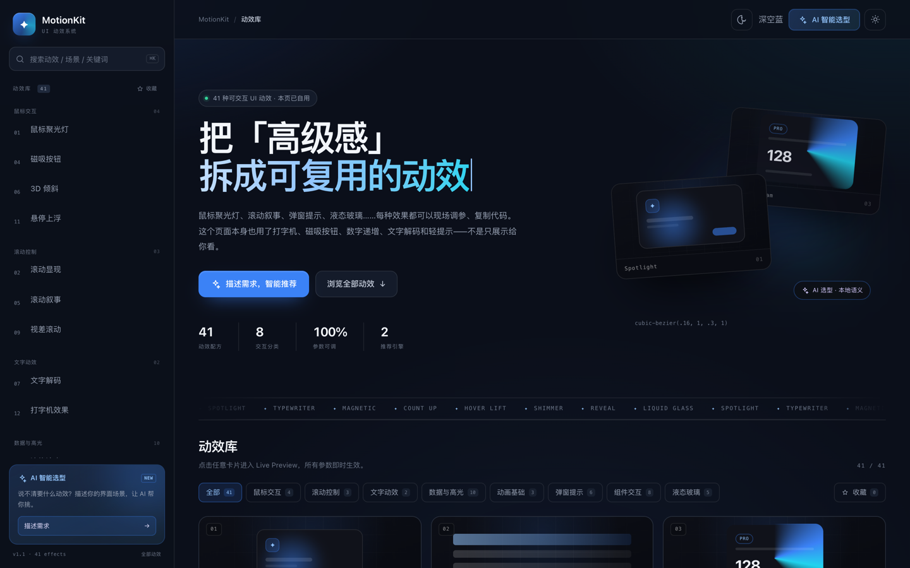
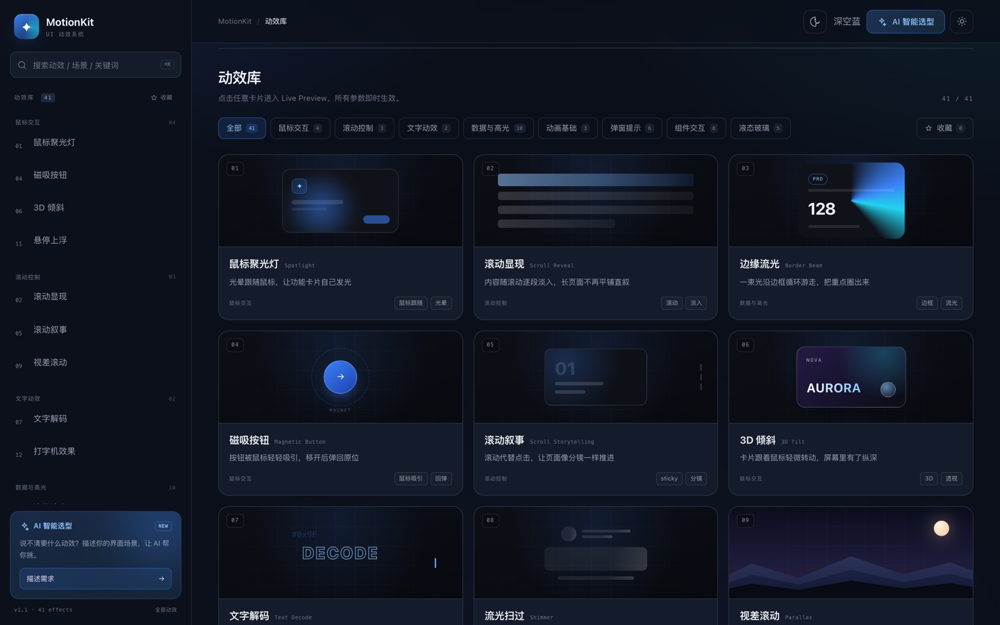
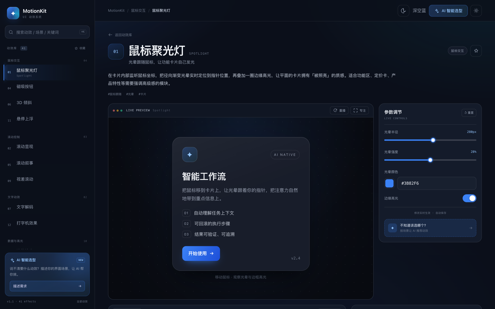
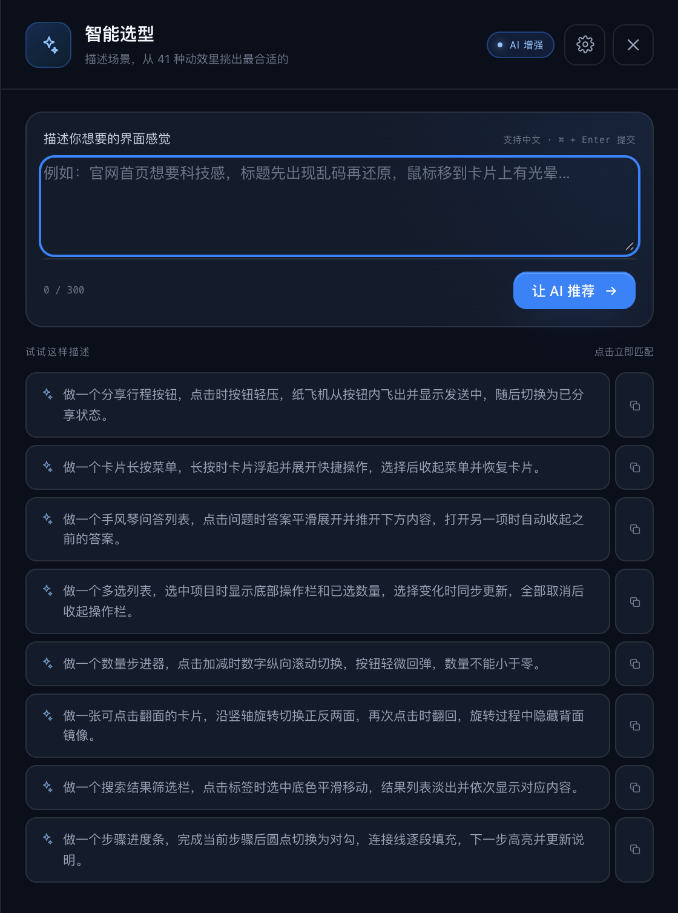
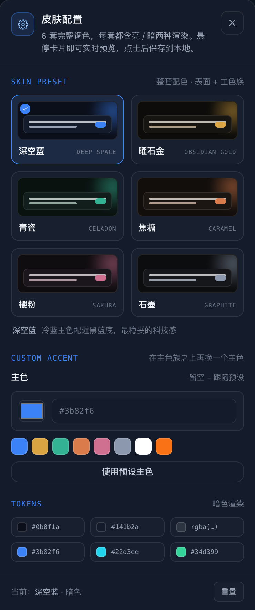
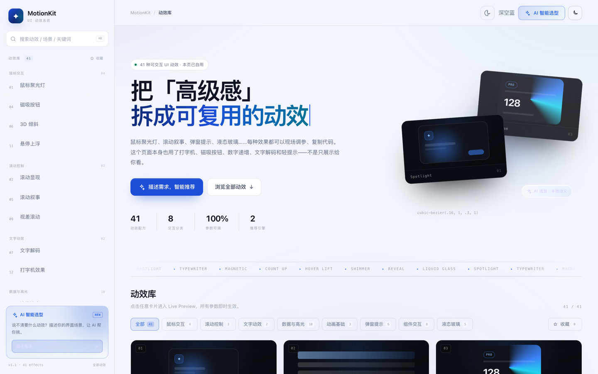
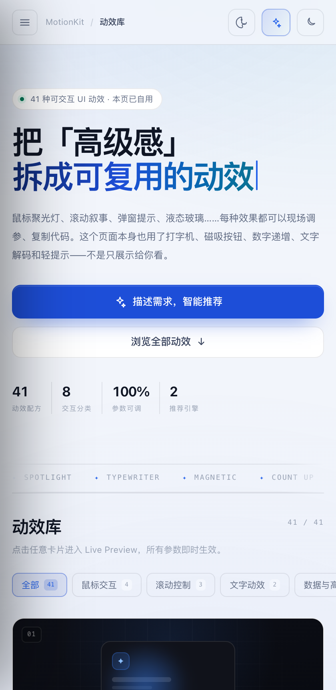

# MotionKit · UI 动效系统

一套可交互的 UI 动效库与展示工作台：**手写动效**、**6 套皮肤 × 亮暗双主题**，支持现场调参、复制代码、按场景智能选型。

没有 UI 库，没有动画库 —— 每个效果都是可以直接抄进项目的 CSS + TypeScript。



```bash
npm install
npm run dev     # http://localhost:5178
```

## 界面一览

**动效库**：8 类筛选、卡片即预览，搜索、收藏、参数记忆都在一屏内。



**动效详情**：左边 Live Preview，右边参数调节，改完直接复制代码。



**智能选型**：一句场景描述，从全部动效里挑出最合适的几个，附匹配度与理由。

**皮肤配置**：6 套调色，亮暗各自渲染，还能再叠一层自定义主色。

<table>
  <tr>
    <td width="64%" valign="top"></td>
    <td width="36%" valign="top"></td>
  </tr>
</table>

**亮色主题**与**移动端**：同一套 token 双主题渲染，窄屏自动堆叠成单列。

<table>
  <tr>
    <td width="77%" valign="top"></td>
    <td width="23%" valign="top"></td>
  </tr>
</table>

## 里面有什么

<!-- effects:table:begin -->
<!-- 由 npm run docs 自动生成，请勿手改这两行标记之间的内容 -->

共 **41** 个动效，分 8 类：

| 分类 | 数量 | 代表动效 |
| --- | --- | --- |
| 鼠标交互 | 4 | 鼠标聚光灯、磁吸按钮、3D 倾斜… |
| 滚动控制 | 3 | 滚动显现、滚动叙事、视差滚动 |
| 数据与高光 | 10 | 边缘流光、流光扫过、数字递增… |
| 文字动效 | 2 | 文字解码、打字机效果 |
| 动画基础 | 3 | 错峰动画、弹性动画、缓动效果 |
| 弹窗提示 | 6 | 模态弹窗、轻提示、抽屉面板… |
| 液态玻璃 | 5 | 液态玻璃、玻璃标签栏、果冻开关… |
| 组件交互 | 8 | 纸飞机发送、长按快捷菜单、手风琴问答… |

<!-- effects:table:end -->

完整清单（含每个动效的适用场景、参数表、实现提示、接入代码）：

- 人 / LLM 读 → **[`docs/EFFECTS.md`](docs/EFFECTS.md)**
- 程序读 → **[`docs/effects.json`](docs/effects.json)**
- 按需求找 → `npm run find -- 弹窗 毛玻璃`

## 给 AI 助手的入口

本仓库按「AI 可读」的方式组织，任何 AI 编码助手请先读 **[AGENTS.md](AGENTS.md)**（Claude Code 读 [CLAUDE.md](CLAUDE.md)）。
里面写清了：动效知识库在哪、新增动效的强制流程、元数据字段为什么不能省、视觉与代码规约。

## 常用命令

```bash
npm run dev         # 开发（自动同步 docs）
npm run build       # 构建（自动同步 docs）
npm run typecheck   # 类型检查
npm run docs        # 重新生成 docs/ 下的动效清单
npm run docs:check  # 校验清单是否落后于 catalog（CI 用）
npm run find -- 关键词…
```

## 配置存哪

主题、皮肤、收藏、各动效参数、模型配置统一存在 `.motionkit/config.json`（由 `server/local-store.mjs` 提供的 `/api/config` 读写，写入走原子替换）。浏览器 localStorage 只作为首屏缓存，接口不可用时自动降级。

> 该文件含明文 API Key，已加入 `.gitignore`。
